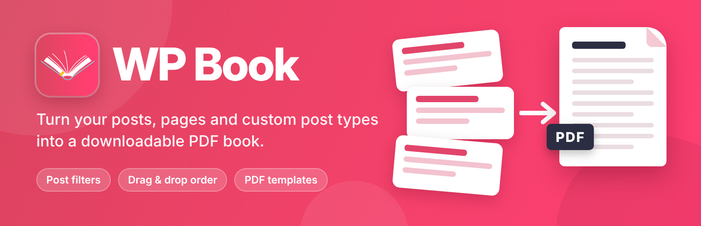
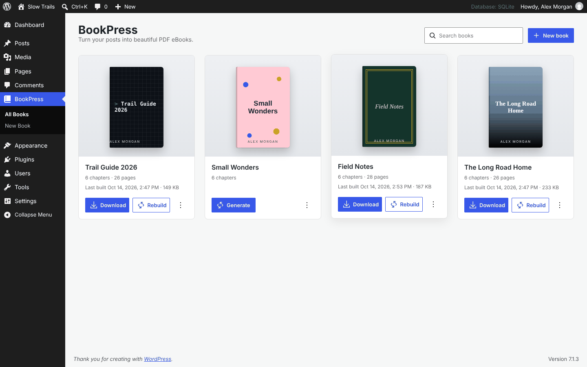
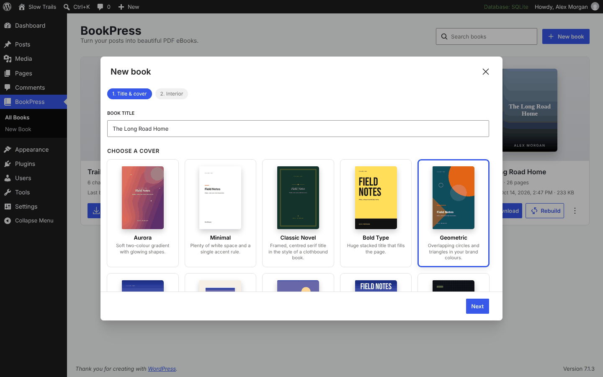
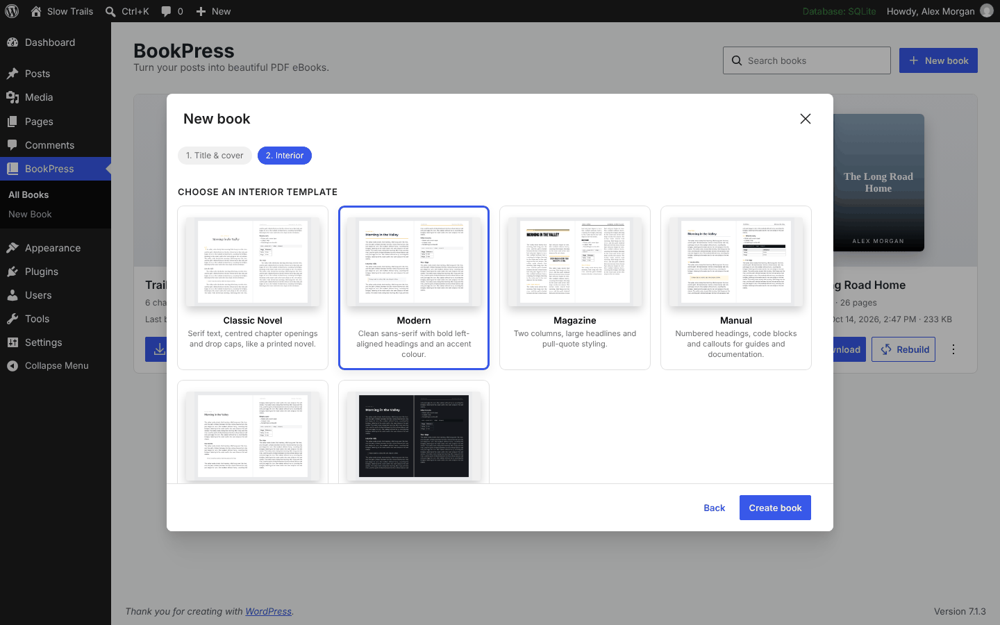
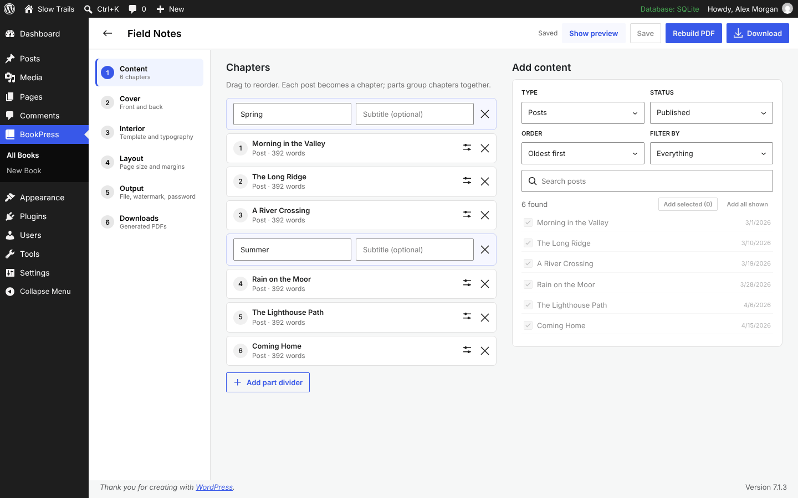
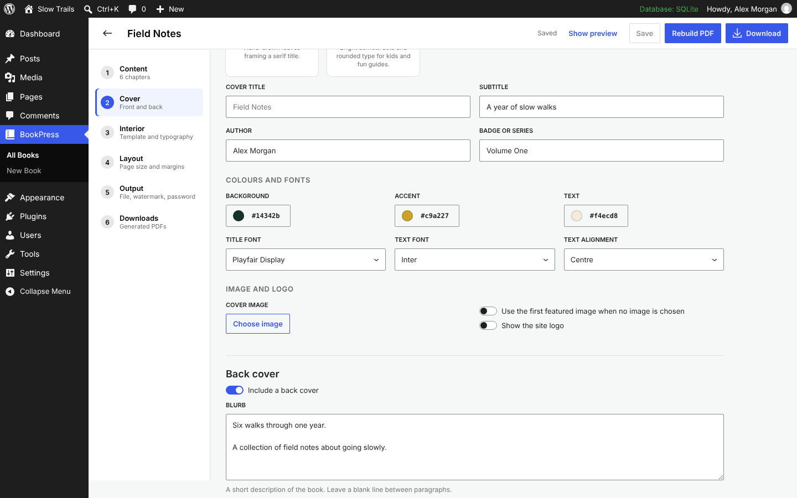
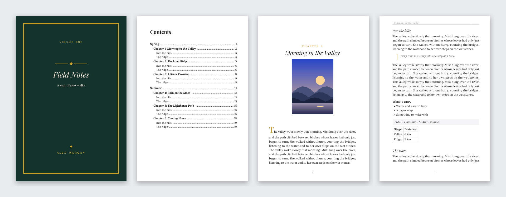

# BookPress – PDF eBook Maker

[](https://wordpress.org/plugins/wp-book/)
[](https://github.com/rajanvijayan/wp-book/actions/workflows/ci.yml)
[](https://www.gnu.org/licenses/gpl-2.0.html)

Turn your WordPress posts and pages into a polished PDF eBook, with a cover, an interior template and a table of contents, and download it from your dashboard. Formerly **WP Book**; the plugin slug is still `wp-book`.

**[Download from WordPress.org](https://wordpress.org/plugins/wp-book/)** · [Video walkthrough](https://www.youtube.com/watch?v=KCanH1viWaQ)

[](https://www.youtube.com/watch?v=KCanH1viWaQ)

## Features

**Covers**
- 12 cover designs, from Minimal and Classic Novel to Full-bleed Photo, Magazine and Tech Guide.
- Edit the title, subtitle, author, badge, colours, fonts, image and alignment.
- **Auto cover:** one click builds a cover from your theme's colours, site logo and first featured image.
- Back cover with a blurb, author bio and QR code.
- **Print cover:** back, spine and front on one sheet with bleed; the spine width follows the page count.

**Interior**
- 6 templates: Classic Novel, Modern, Magazine, Manual, Minimal and Dark Reader.
- Font, size, line height, justification, paragraph indents and drop caps.
- Title, copyright, dedication and preface pages, a linked table of contents, part dividers, running headers and page numbers.
- Trade book sizes (6×9, 5.5×8.5, 5×8 and more), A4, A5 and Letter, mirrored margins and right-hand chapter starts.
- PDF bookmarks, metadata, watermark and password.

**Workflow**
- Saved books with drag-and-drop chapters and a content picker that filters by type, status, category and tag.
- Live preview of the cover and sample pages.
- Background generation with progress, so large books don't time out (a 500-post, 1,000-page book builds in under 20 seconds within 128 MB).
- Download history per book through an authenticated link.
- Optional font packs for Chinese, Japanese, Korean, Arabic, Hebrew, Indic and other scripts.

## Screenshots

| Your books | Cover designs |
|---|---|
|  |  |
| **Interior templates** | **Chapters and preview** |
|  |  |
| **Cover editor** | **A finished book** |
|  |  |

## Requirements

| | |
|---|---|
| WordPress | 6.4 or later |
| PHP | 7.4 or later, including 8.4 |

## Installation

1. In WordPress, go to **Plugins → Add New**, search for **BookPress**, then install and activate it.
2. Open **BookPress** in the admin menu and click **New book**.
3. Pick a cover and an interior template, add chapters, then click **Generate PDF** and **Download**.

## Development

Requires PHP 7.4+, [Composer](https://getcomposer.org/) and Node 20. `vendor/`, `vendor-prefixed/` and `build/` are not committed.

```bash
git clone https://github.com/rajanvijayan/wp-book.git
cd wp-book
composer install      # mPDF (prefixed by Strauss into vendor-prefixed/), Action Scheduler and dev tools
npm ci && npm run build   # admin app: assets/src → build/
composer lint         # PHPCS: WordPress Coding Standards + PHPCompatibilityWP
npm run lint:js       # ESLint
npm start             # rebuild the admin app on change
```

Symlink or copy the folder into `wp-content/plugins/` of a WordPress install to try it.

`composer install` also removes mPDF's optional fonts (`bin/trim-fonts.php`); they are the downloadable font packs listed in `src/render/font-packs.php`.

### Tests

```bash
bin/install-wp-tests.sh wordpress_test root '' localhost latest   # WordPress + test library + database
WP_TESTS_DIR=/tmp/wordpress-tests-lib vendor/bin/phpunit
php tests/smoke-pdf.php                                           # PDF smoke test without WordPress
```

CI runs PHPCS, ESLint, the build on PHP 7.4–8.4, PHPUnit on PHP 7.4 + WordPress 6.4 and PHP 8.3 + the latest WordPress, and Plugin Check on the release copy.

### Project layout

```
wp-book.php           Plugin bootstrap
src/                  Classes in the WPBook\ namespace (Composer classmap)
  books/              Book post type, schema, repository, page sizes
  rest/               REST API (wp-book/v2)
  render/             Book renderer, mPDF engine, content filter, fonts and font packs
  covers/             Cover registry, auto cover, print wrap cover
  templates/          Interior template registry
  jobs/               Background generation (Action Scheduler)
  files/              Protected storage for generated PDFs
  admin/              Admin screen that mounts the React app
  legacy/             WP Book 1.x compatibility
templates/            Cover, interior and page templates (overridable from {theme}/bookpress/)
assets/src/           Admin app source (React)
fonts/                Bundled OFL fonts for covers and headings
bin/                  Dev scripts: thumbnails, font builds, font trimming, test installer
.wordpress-org/       Banners, icons and screenshots for the WordPress.org plugin page
```

### Customising

Copy any file from `templates/` to a `bookpress/` folder in your theme to override it. Add designs with the `wpbook_covers` and `wpbook_templates` filters, and change who can manage books with `wpbook_base_capability` (default `edit_others_posts`).

### Releasing

GitHub is the source of truth, and WordPress.org SVN is updated only by GitHub Actions. Pushing a version tag deploys to WordPress.org, so read [RELEASING.md](RELEASING.md) first.

## License

[GPLv2 or later](https://www.gnu.org/licenses/gpl-2.0.html). Bundled fonts are under the SIL Open Font License; mPDF is GPLv2.
