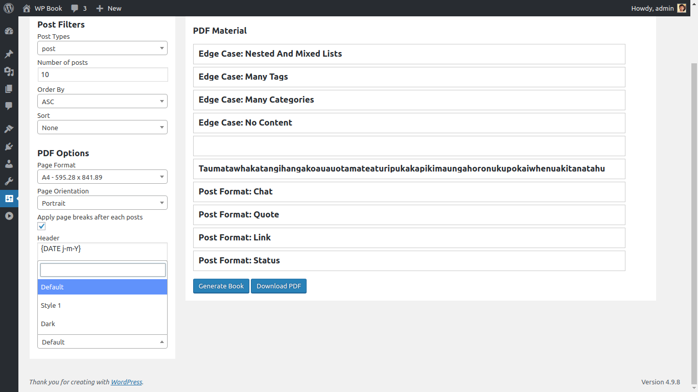

# WP Book

[](https://wordpress.org/plugins/wp-book/)
[](https://github.com/rajanvijayan/wp-book/actions/workflows/ci.yml)
[](https://www.gnu.org/licenses/gpl-2.0.html)

Turn your WordPress posts, pages and custom post types into a downloadable PDF book in a few clicks.

**[Download from WordPress.org](https://wordpress.org/plugins/wp-book/)** · [Overview video](https://www.youtube.com/watch?v=nBIG8jT8aNY)

## Features

**Choose your content**
- Build a book from posts, pages or any public custom post type.
- Limit how many entries go into the book.
- Sort entries by ID, author, title, slug, type, published date, modified date, parent or at random, in ascending or descending order.
- Rearrange the selected entries by hand with drag and drop.

**Shape the PDF**
- More than 50 paper sizes, including the A, B, C and RA series, Letter, Legal, Tabloid and Executive.
- Portrait or landscape orientation.
- An optional page break after each post.
- A custom header and footer with `{PAGENO}` and `{DATE j-m-Y}` placeholders.
- Default, Style 1 and Dark templates.

Generated books are saved to `wp-content/uploads/wp-book/`.

## Screenshots

| Book builder | Book generated |
|---|---|
|  |  |
| **Sample PDF page** | **Post type filter** |
|  |  |
| **Page format** | **Header and footer** |
|  |  |
| **Templates** | |
|  | |

## Requirements

| | |
|---|---|
| WordPress | 3.8 or later |
| PHP | 7.1 or 7.2 |

Version 1.0.1 bundles mPDF 7.1, which does not support PDF generation on PHP 8.

## Installation

1. In WordPress, go to **Plugins → Add New**, search for **WP Book**, then install and activate it.
2. Go to **Settings → WP Book**.
3. Set your filters and PDF options, arrange the entries, then click **Generate Book** and **Download PDF**.

## Development

Requires PHP and [Composer](https://getcomposer.org/). `vendor/` is not committed.

```bash
git clone https://github.com/rajanvijayan/wp-book.git
cd wp-book
composer install      # runtime dependencies (mPDF) and dev tools
composer lint         # PHPCS: WordPress Coding Standards + PHPCompatibilityWP
composer lint:fix     # auto-fix what PHPCBF can
```

To test it locally, symlink or copy the folder into `wp-content/plugins/` of a WordPress install that runs PHP 7.1 or 7.2.

### Project layout

```
wp-book.php           Plugin bootstrap
src/                  PSR-4 classes (WPBook\ namespace)
  Main.php            Wires up hooks
  admin/Controller.php  Settings page, AJAX handlers, PDF generation
  view/Controller.php   PDF templates
  utils/              Loader, activation, deactivation, i18n
assets/               Admin CSS and JS
languages/            Translation template (wp-book.pot)
.wordpress-org/       Banners, icons and screenshots for the WordPress.org plugin page
```

### Releasing

GitHub is the source of truth, and WordPress.org SVN is updated only by GitHub Actions. Pushing a version tag deploys to WordPress.org, so read [RELEASING.md](RELEASING.md) first.

## License

[GPLv2 or later](https://www.gnu.org/licenses/gpl-2.0.html).
